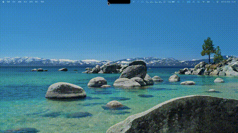

<h1 align="center">
  <br>
  <!-- 图标：请替换为 DeskPet 项目图标 -->
  
  <br>
  DeskPet
  <br>
</h1>

<p align="center">
  
  <a href="https://github.com/2048Nemo/DeskPet/releases">
    
  </a>
  
  
</p>

<!-- 预览图：请替换为 DeskPet 的 GIF/截图 -->
<p align="center">
  
</p>

---

**DeskPet** 是一款 macOS 桌面宠物应用，让你的菜单栏刘海住进一只活灵活现的小宠物 🐾。支持任意序列帧素材换肤——猫、狗、兔子，任何你喜欢的宠物形象都可以。

它基于 [boring.notch](https://github.com/TheBoredTeam/boring.notch) 构建，在保留原版刘海动态岛功能（音乐控制、日历、文件暂存、HUD 替换）的基础上，新增了完整的**桌面宠物系统**：

- 🐾 **序列帧动画引擎** — 支持 24fps 高帧率动画，部分帧预缓存 + 流式补齐，内存占用极低（~200MB）
- 🏠 **回窝/出窝** — 宠物可以回刘海里睡觉，拖到刘海区域松手即瞬间进窝
- 🚶 **行为 AI** — 自主走动、打哈欠、睡觉、开心蹦跳，活动频率可自定义
- 💬 **对话气泡** — 头顶气泡自言自语 + 接入任意 LLM 对话（OpenAI 兼容接口，流式回复）
- 📚 **RAG 知识库** — 导入文档生成向量，对话时自动引用你的资料回答
- 🎵 **音乐联动** — 播放音乐时宠物会跳舞（需提供跳舞素材）
- 🖱️ **丰富交互** — 单击戳一戳、双击回窝/出窝、拖拽拎起走动、拖到刘海自动打开宠物面板
- 🎨 **可换肤** — 任意序列帧素材即可作为皮肤（支持 seeDance 等 AI 视频抽帧）
- ⚙️ **可调节** — 活动频率（Chill/Normal/Hyper + 自定义）、宠物大小、音效音量

## 📋 功能一览

### 桌面宠物（本项目新增）

| 功能 | 说明 |
|------|------|
| 序列帧动画 | PNG 序列帧，24fps，部分帧缓存 + 流式解码 |
| 行为状态机 | idle / walk / sleep / yawn / happy / hurt / drag / fall |
| 待机变体轮换 | 多套待机动画随机切换，不单调 |
| 拖拽投放刘海 | 拖宠物到刘海区域 → 自动打开宠物面板，松手瞬间进窝 |
| 回窝节能 | 回窝后卸载所有活动动画帧，内存降至 ~120MB |
| 音效系统 | 每个动作可配独立音效，音量独立可调 |
| 头顶气泡 | 宠物自言自语 + 对话；气泡大小 / 说话频率可调，样式可换肤 |
| 接入 LLM 对话 | 兼容任意 OpenAI Chat Completions 接口（OpenAI / DeepSeek / Ollama 等），流式回复 |
| RAG 知识库 | 导入文档 → 分块 → 向量化 → 对话时自动检索引用你的资料 |

### 原版刘海功能（继承自 boring.notch）

- 🎧 音乐播放控制 + 实时可视化
- 📆 日历 / 提醒事项集成
- 📚 文件暂存架（支持 AirDrop）
- 🎚️ 系统 HUD 替换（音量 / 亮度 / 键盘背光）
- 🔋 充电指示器
- 📷 镜子（摄像头预览）

---

## 安装

### 系统要求

- macOS **14 Sonoma** 或更高
- Apple Silicon 或 Intel Mac

### 下载安装

<a href="https://github.com/2048Nemo/DeskPet/releases/latest">
  
</a>

1. 从 [Releases](https://github.com/2048Nemo/DeskPet/releases/latest) 下载 `.dmg` 文件
2. 打开 `.dmg`，将 **DeskPet** 拖到 `/Applications` 文件夹

> [!IMPORTANT]
> 本项目使用 ad-hoc 签名，未上架 / 无开发者证书。首次打开若被 macOS 拦截，请右键 →「打开」，
> 或运行一次解除隔离：
>
> ```bash
> xattr -dr com.apple.quarantine /Applications/deskpet.app
> ```

---

## 使用

### 桌面宠物

- **单击宠物**：戳一戳（心情好会开心蹦跳，心情差会委屈）并弹出操作面板
- **双击宠物**：回窝睡觉 / 出窝活动
- **拖拽宠物**：拎起来走动；拖到刘海区域松手 → 瞬间进窝 + 打开宠物面板
- **宠物面板**（刘海展开后 Pet 标签页）：查看心情/清洁度、抚摸、召回/出窝、聊天、调节音效音量

### 气泡对话（本项目新增）

- **自言自语**：每隔一段时间（默认 2 分钟）宠物会按当前动作随机说一句话，气泡显示几秒后自动消失
- **打开对话**：点击宠物面板的 💬 或点气泡上的「聊天」→ 气泡变成输入框，回车发送
- **当前对话**：气泡只显示最近一轮问答（你的问题 + 宠物流式回复）
- **历史记录**：完整对话在 **设置 → Chat → Conversation history** 查看，可清空
- 气泡大小、说话频率在 **设置 → Pet → Speech bubble** 调整

### 接入 LLM 对话（设置 → Chat）

| 配置项 | 说明 |
|--------|------|
| Base URL | OpenAI 兼容接口地址，如 `https://api.openai.com/v1`、`http://localhost:11434/v1`（Ollama） |
| API Key | 本地模型（Ollama / LM Studio）可留空 |
| Model | 如 `gpt-4o-mini` / `deepseek-chat` / `qwen2.5` |
| System prompt | 宠物人设，决定它怎么说话，可随意改写 |
| Test Connection | 一键验证连接 |

> 支持任意 OpenAI Chat Completions 兼容服务；Base URL 只填域名也会自动补全 `/v1/chat/completions`。

### RAG 知识库（设置 → RAG）

让宠物能回答你自己的文档内容：

1. 在 **Chat** 页配置好 Base URL / API Key
2. 在 **RAG** 页填写 Embedding 模型（OpenAI 用 `text-embedding-3-small`，Ollama 用 `nomic-embed-text`）
3. 点 **Import documents…** 导入 `.txt` / `.md` 等文本文件
4. 之后对话时，宠物会自动检索最相关的片段并引用它们回答

向量与文本保存在本机 `~/Library/Application Support/DeskPet/vectorstore.json`，可删除单篇或一键清空。

### 刘海动态岛

- 鼠标悬停刘海 → 展开查看音乐/日历/文件架
- 点击菜单栏图标 → 打开设置
- 拖文件到刘海 → 自动打开文件架

---

## 从源码构建

### 前置要求

- **macOS 15.6+**
- **Xcode 26+**

### 步骤

```bash
git clone https://github.com/2048Nemo/DeskPet.git
cd DeskPet
open deskpet.xcodeproj
```

在 Xcode 中按 `Cmd + R` 构建运行。

> 也可以用命令行构建 / 一键打包 DMG：
> ```bash
> ./tools/build_dmg.sh            # Release 编译 + 生成 DMG（ad-hoc 签名，含必需修复）
> ./tools/build_dmg.sh --run      # Debug 编译并直接运行（开发调试用）
> ```
> 手动 xcodebuild 时请注意：必须加 `ENABLE_HARDENED_RUNTIME=NO`，
> 否则内置的 MediaRemoteAdapter.framework 签名不一致会导致启动崩溃。

> [!NOTE]
> 依赖从 GitHub 拉取。若你的网络访问 GitHub 不稳定（如国内），可配置一次镜像加速：
> ```bash
> git config --global url."https://gitclone.com/github.com/".insteadOf "https://github.com/"
> ```

---

## 桌面宠物素材

宠物素材放在 `~/Pictures/BoringPet/` 目录下，每个动作是一个子文件夹（编号 PNG 序列帧）。

详见 **[PET.md](PET.md)** 和 **[docs/DESIGN.md](docs/DESIGN.md)**。

支持用 seeDance 等 AI 工具生成视频后抽帧作为皮肤。

---

## 🔧 拓展指南（开发者）

### 改宠物台词

固定台词在 `deskpet/components/Pet/PetBubbleManager.swift` 的 `phrases` 字典，
每个动作对应一个字符串数组，每次随机抽一句。直接增删/修改即可：

```swift
private let phrases: [PetAction: [String]] = [
    .idle: ["工作累了吗？", "你终于回来了！"],   // 待机自言自语
    .walk: ["出去溜达一下～"],                   // 走路
    .sleep: ["Zzz…"], .happy: [...], .hurt: [...], .yawn: [...], ...
]
```

### 换气泡样式

气泡渲染是可插拔接口 `PetBubbleRendering`（定义在 `PetBubbleManager.swift`）。
实现它并替换 `PetBubbleManager.shared.rendering`，即可整体换肤，聊天 / 定时说话 /
LLM 调用全部复用：

```swift
struct 我的气泡: PetBubbleRendering {
    var name: String { "我的风格" }
    func makeRootView() -> AnyView {
        AnyView(我的气泡视图())   // 内部用 PetBubbleManager.shared 读状态 / 触发动作
    }
}
// 初始化时：PetBubbleManager.shared.rendering = 我的气泡()
```

新样式可用：`current`（userText / petText / isStreaming）、`isInputActive`、
以及 `send(_:)` / `openInput()` / `closeInput()` / `dismissBubble()`。

### 接入自己的向量库（RAG）

`VectorStoreProviding`（`deskpet/Providers/VectorStoreProviding.swift`）是向量库统一接口，
实现后注册到 `VectorStoreManager.shared.providers`，对话即自动启用检索：

```swift
final class 我的向量库: VectorStoreProviding {
    var name: String { "我的向量库" }
    var isConfigured: Bool { true }
    func upsert(_ docs: [VectorDocument]) async throws { /* 写入你的存储 */ }
    func search(query: String, embedding: [Double]?, topK: Int) async throws -> [VectorSearchResult] { /* 返回最相关 topK 条 */ }
    func delete(ids: [String]) async throws { }
    func clear() async throws { }
}
```

内置实现：`LocalVectorStore`（本地 JSON + 余弦相似度），参考它即可。

### 架构速览（对话 / RAG）

| 文件 | 职责 |
|------|------|
| `PetBubbleManager.swift` | 气泡状态机：定时说话、跟随宠物、窗口管理、换肤接口 |
| `PetBubbleView.swift` | 默认气泡样式（`DefaultPetBubbleRendering` / `DefaultPetBubbleView`） |
| `PetChatManager.swift` | LLM 客户端：Chat Completions / Embeddings、流式、历史持久化、RAG 注入 |
| `VectorStoreManager.swift` | 向量库注册中心 + 检索入口 |
| `LocalVectorStore.swift` | 本地 JSON 向量库（默认实现） |
| `RAGManager.swift` | 文档导入 → 分块 → 向量化 的数据流编排 |

---

## 🛣️ Roadmap

### 桌面宠物
- [x] 序列帧动画引擎 + 行为 AI
- [x] 回窝/出窝 + 拖拽投放刘海
- [x] 部分帧预缓存 + 流式补齐（低内存）
- [x] 多套待机变体轮换
- [x] 活动频率 / 音效音量自定义
- [x] 头顶气泡：自言自语 + 对话（样式可换肤）
- [x] 接入 LLM 对话（OpenAI 兼容接口，流式）
- [x] RAG 知识库（文档导入 → 向量化 → 对话引用）
- [ ] 更多行为（吃东西、玩耍、互动小游戏）
- [ ] 皮肤市场 / 社区分享
- [ ] 多宠物同屏
- [ ] 气泡样式在设置里可切换

### 继承自原版
- [x] 音乐控制 + 可视化
- [x] 日历 / 提醒 / 文件架 / HUD 替换
- [ ] 蓝牙设备活动
- [ ] 天气集成

---

## 🤝 致谢

本项目基于开源项目 **[boring.notch](https://github.com/TheBoredTeam/boring.notch)** 构建，感谢原项目作者 [TheBoredTeam](https://github.com/TheBoredTeam) 的杰出工作。

### 依赖的开源项目
- **[boring.notch](https://github.com/TheBoredTeam/boring.notch)** — 刘海动态岛核心（GPLv3）
- **[MediaRemoteAdapter](https://github.com/ungive/mediaremote-adapter)** — macOS 15.4+ 媒体控制
- **[NotchDrop](https://github.com/Lakr233/NotchDrop)** — 文件架功能参考

本项目继承 GPLv3 协议开源。

---

<p align="center">
  Made with 🫶🏻 for pet lovers
</p>
